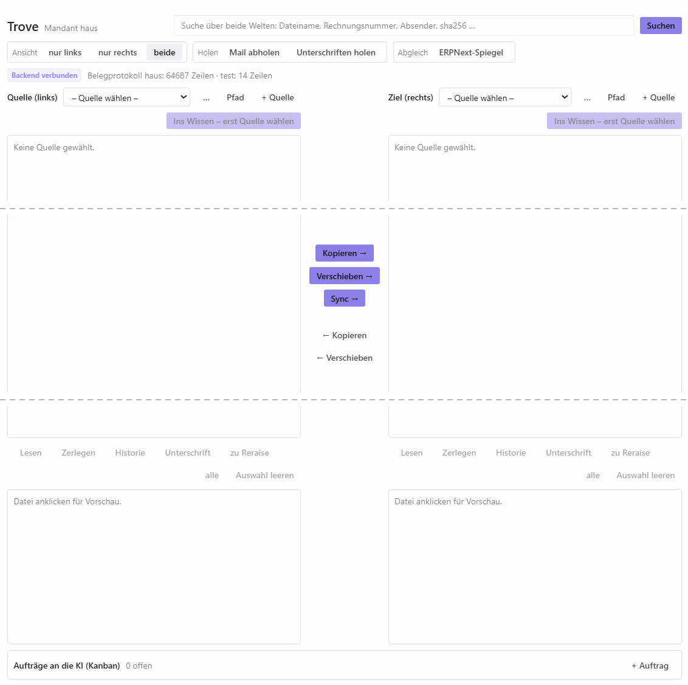
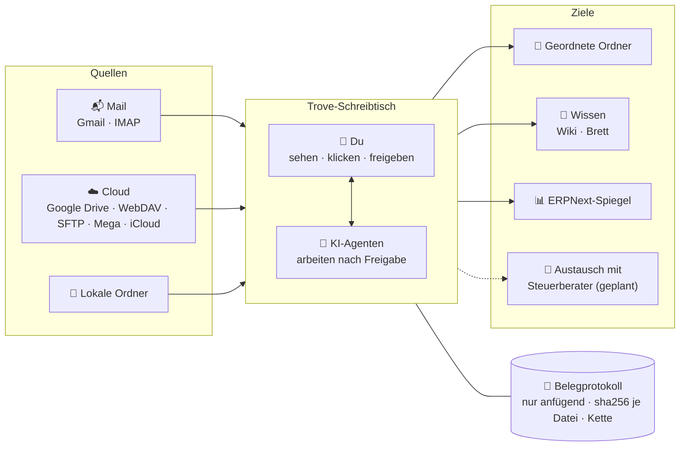

<div align="center">


<p>
  <strong>Der Aufräum-Schreibtisch, an dem du und deine KI-Agenten gemeinsam Datei-Chaos ordnen.</strong><br>
  Du siehst, klickst und gibst frei. Die Agenten erledigen die Arbeit. Jeder Schritt ist fälschungssicher protokolliert.
</p>

<p>
  <a href="LICENSE"></a>
  
  <a href="https://hermes-agent.nousresearch.com/desktop"></a>
  
  
  
</p>

<p>
  <a href="#-warum-trove">Warum Trove</a> ·
  <a href="#-so-funktionierts">So funktioniert's</a> ·
  <a href="#-was-heute-funktioniert">Was heute funktioniert</a> ·
  <a href="#-anwendungen">Anwendungen</a> ·
  <a href="#-schnellstart">Schnellstart</a> ·
  <a href="#-faq">FAQ</a> ·
  <a href="README.md">English</a>
</p>

</div>

---

Trove legt Postfächer, Cloud-Speicher und Ordner nebeneinander auf einen Schreibtisch. Du siehst dir ein Dokument an, prüfst es, vergleichst es und legst es dorthin, wo es hingehört. Deine KI-Agenten helfen an denselben Dateien. Ein Auftrag an einen Agenten wartet, bis du ihn freigibst. Jedes Kopieren, Verschieben und Prüfen landet in einem Belegprotokoll, das nur ergänzt und als Kette verknüpft wird. So lässt sich immer nachvollziehen, woher ein Dokument kommt und was mit ihm passiert ist.

Trove läuft auf deinem Rechner. Deine Dateien bleiben, wo sie sind.

## 🖥️ Bildschirmfoto

<div align="center">
  
  <br>
  <sub>Aktuelle Oberfläche, leerer Zustand. Die gestrichelten Linien markieren gekürzten Leerraum. <a href="docs/assets/trove-ui-empty-state-full.png">Bildschirmfoto in voller Höhe</a>.</sub>
</div>

<!-- TODO: kurzes GIF ergänzen: Mail-Quelle wählen, Beleg in der Vorschau, in einen Ordner kopieren, Eintrag im Protokoll zeigen. -->

## ✨ Warum Trove

Die meisten Dokumenten-Werkzeuge sind Archive: Dateien kommen hinein, das Werkzeug verwaltet sie. Das eigentliche Problem liegt davor. Rechnungen stecken in drei Postfächern, Verträge in irgendeinem Google Drive, Scans auf dem Desktop, Dubletten überall. Genau dafür ist Trove gebaut.

<table>
  <tr>
    <td width="33%" valign="top">
      <h3>🧑‍💻🤝🤖 Du und deine Agenten, ein Tisch</h3>
      Zwei Spalten, echte Dateien, echte Vorschau. Die Agenten machen die Fleißarbeit, der letzte Klick bleibt bei dir.
    </td>
    <td width="33%" valign="top">
      <h3>✅ Nichts ohne dich</h3>
      Ein Auftrag an einen Agenten startet gesperrt. Er läuft erst nach deiner Freigabe, das Ergebnis landet im Protokoll.
    </td>
    <td width="33%" valign="top">
      <h3>🔗 Jeder Schritt belegt</h3>
      Das Protokoll wird nur ergänzt, ist als Kette verknüpft und hat einen Anker außerhalb. Jede Kopie wird zurückgelesen und geprüft.
    </td>
  </tr>
  <tr>
    <td width="33%" valign="top">
      <h3>🏠 Lokal zuerst</h3>
      Läuft auf deinem Rechner. Keine Telemetrie. Netzwerk nur zu Diensten, die du selbst einrichtest.
    </td>
    <td width="33%" valign="top">
      <h3>🛡️ Überschreibt nie</h3>
      Konflikte werden protokolliert statt still gelöst. Verschieben löscht die Quelle erst nach der Gegenprobe.
    </td>
    <td width="33%" valign="top">
      <h3>🧾 Versteht Belege</h3>
      Liest E-Rechnungen, PDF-Text und lokale OCR und prüft dann mit festen Regeln für Deutschland 🇩🇪 und Argentinien 🇦🇷.
    </td>
  </tr>
</table>

## 🧭 So funktioniert's



## 📋 Was heute funktioniert

Trove ist früh dran. Das gibt es schon, und das kommt als Nächstes:

| Bereich | Funktion | Status |
| --- | --- | :---: |
| **Schreibtisch** | Zwei Spalten mit Ordner-Navigation und Dubletten-Filter | ✅ |
| | Kopieren · Verschieben · Sync mit Gegenprobe, überschreibt nie | ✅ ¹ |
| | Vorschau für PDFs (seitenweise) und Bilder | ✅ |
| | Nebeneinander, auch in zwei Fenstern (z. B. zweiter Monitor) | ✅ |
| | Änderungen prüfen: neu, weg, verschoben, von außen geändert | ✅ |
| | Suche über Ordner, Protokoll, ERPNext und Paperless-ngx | ✅ |
| | PDF-Stapel in einzelne Belege zerlegen (über [Stirling-PDF](https://github.com/Stirling-Tools/Stirling-PDF)) | ✅ |
| | Umbenennen, neuer Ordner, Sortieren | 🔜 |
| | PDF kommentieren, Notiz und Korrektur mit Häkchen „geprüft“ | 🔜 |
| | Drucken, PDFs zusammenfügen, Inhalte vergleichen | 🔜 |
| **Quellen** | Gmail (nur lesend) und IMAP, Anhänge mit Prüfsumme | ✅ |
| | Cloud über [rclone](https://rclone.org/): Google Drive, WebDAV, SFTP, Mega, iCloud (nur lesend) | ✅ |
| | Lokale Ordner, iCloud Drive auf dem Mac | ✅ |
| **Agenten** | Aufträge an die KI, gesperrt bis zur Freigabe | ✅ |
| | MCP-Zugang für andere Agentensysteme, mit derselben Freigabe | 🔜 |
| **Protokoll & Belege** | Fälschungssicheres Protokoll, nur anfügend, mit Anker | ✅ |
| | Belege lesen: E-Rechnung (ZUGFeRD / Factur-X) → PDF-Text → lokale OCR | ✅ |
| | Verprobung: Summen, Steuersätze, CUIT, IBAN, USt-IdNr. | ✅ |
| | Argentinien: CAE- und QR-Prüfung von ARCA-Rechnungen | 💡 |
| **Automatik** | Überwachte Ordner nach Zeitplan ins Wissen nachführen | ✅ |
| | Regeln: Quelle → Aktion → Ziel nach Zeitplan, Freigabe wählbar | 🔜 |
| **Einrichtung** | Ein Modus für alle, Schreibrecht pro Ordner | 🔜 |
| | Automatische Tests, Musterordner, Demo-Video | 🔜 |
| **Optional** | ERPNext-Spiegel, Unterschriften über [DocuSeal](https://github.com/docusealco/docuseal), Wissenskarten | ✅ ¹ |

✅ funktioniert · 🔜 als Nächstes geplant · 💡 Idee

<sub>¹ In der Standardeinstellung läuft Trove derzeit im Kundenmodus: Die Ablage wird nur gelesen, Kopieren, Verschieben und DocuSeal sind aus. Diesen Modus abzuschaffen ist der erste Punkt der Roadmap.</sub>

## 🧩 Anwendungen

**🧹 Aufräumen mit Agenten.** Postfach und Drive anbinden, durchsehen, Dubletten finden und das Wichtige in eine saubere Ordnerstruktur bringen. Die mühsame Arbeit gibst du an einen Agenten ab, gibst sie frei und prüfst das Ergebnis im Protokoll.

**🧠 Wissen überführen.** Einen Ordner „ins Wissen“ geben: Jede Datei bekommt einen Text-Zwilling, der per Prüfsumme an das Original gebunden ist, dazu eine Wissenskarte fürs Wiki oder das Brett. Überwachte Ordner bleiben von selbst aktuell.

**🤝 Belege nachvollziehbar übergeben.** Mandanten und Steuerberater tauschen Belege über verbundene Cloud-Ordner aus, und das Protokoll zeigt, wer was wann übergeben hat. Die Bausteine gibt es heute. Ein eigener Austausch-Ablauf steht auf der Roadmap.

## 🚀 Schnellstart

<details open>
<summary><strong>Als Hermes-Desktop-Plugin installieren</strong></summary>

<br>

**Voraussetzungen:** [Hermes Desktop](https://hermes-agent.nousresearch.com/desktop) ab 0.19, Python 3.

```bash
git clone https://github.com/Reraise-ai/trove.git
cd trove
python tools/installieren.py
```

Hermes neu laden (oder neu starten). In der Seitenleiste erscheint der Tab **Trove**.

- Der Installer findet den Hermes-Ordner unter Windows, macOS und Linux. Klappt das nicht, `HERMES_HOME` setzen oder `--hermes-home` angeben und erneut ausführen.
- Er legt `config.yaml` an, falls sie fehlt, und schaltet das Plugin ein. Eine bestehende `config.yaml` wird vorher gesichert. Zweimal ausführen schadet nicht.
- OCR-Pakete (`onnxruntime`, `rapidocr-onnxruntime`) sind optional. Ohne sie läuft Trove ohne Texterkennung.
- Gesundheitscheck: `python tools/installieren.py --pruefen` (installiert nichts, nennt nur, was fehlt).

| Option | Wirkung |
| --- | --- |
| `--mandant <name> --datenwurzel <ordner>` | Name des Mandanten und Datenordner von Trove |
| `--venv [ordner]` | eigene Python-Umgebung (Mac-Standard `~/.trove-venv`) |
| `--wheels <ordner>` | Python-Pakete offline installieren |
| `--dauerlauf [minuten]` | überwachte Ordner nachführen (Standard 30, `0` = aus) |
| `--kartenziel wiki\|brett` | Wissenskarten ins Wiki (Standard) oder aufs Brett |

</details>

<details>
<summary><strong>Konfiguration</strong></summary>

<br>

Trove hat keine festen Pfade. Es gilt diese Reihenfolge: Umgebungsvariable vor `trove.json` (vom Installer geschrieben) vor Standardwert.

| Variable | Bedeutung |
| --- | --- |
| `TROVE_DATEN` | Datenordner, ein Unterordner je Mandant (Standard `~/Trove`) |
| `TROVE_MANDANT` | aktiver Mandant |
| `TROVE_REPO` | Ort dieses Repos für das Hermes-Plugin |
| `TROVE_REGISTER_DB` | optionales Register einer früheren Quelle (nur lesend) |
| `TROVE_STIRLING` | Stirling-PDF-Adresse (Standard `http://127.0.0.1:8090`) |
| `TROVE_OLLAMA` | Ollama-Adresse für optionale OCR-Modelle (Standard `http://127.0.0.1:11434`) |
| `TROVE_PAPERLESS`, `TROVE_PAPERLESS_TOKEN` | Paperless-ngx-Adresse und Token-Datei |
| `TROVE_DOCUSEAL`, `TROVE_DOCUSEAL_SCHLUESSEL` | DocuSeal-Adresse und Schlüsseldatei |
| `TROVE_ERPNEXT`, `TROVE_ERPNEXT_KEYS` | ERPNext-Adresse und Ordner mit `api_key.txt` / `api_secret.txt` |
| `TROVE_KARTENZIEL`, `TROVE_WIKI` | Ziel der Wissenskarten (`wiki` / `brett`) und Wiki-Ordner |
| `TROVE_QUELLORT` | Registerspalte `ort` für `gegenprobe.py` und `trove_laeufer.sh` (Standard `quelle`) |

`trove_laeufer.sh` braucht zusätzlich `TROVE_SERVER`, `TROVE_REGISTER_WIN`, `TROVE_ZIEL_WIN` und `TROVE_REPO_WIN` (siehe Kopf des Skripts). Geheimnisse werden nur aus Dateien oder Umgebungsvariablen gelesen und liegen nie im Repo.

</details>

<details>
<summary><strong>Netzwerk und Hintergrundläufe</strong></summary>

<br>

- Keine Telemetrie.
- Netzwerkzugriffe gibt es nur, wenn du sie einrichtest: eigenes ERPNext, DocuSeal oder Paperless-ngx, Gmail (nur lesend, über das vorhandene Hermes-Google-Token) und reraise.ai für öffentliche Wissenskarten (nur mit hinterlegtem Reraise-Schlüssel).
- OCR und das Zerlegen von PDFs laufen als eigener lokaler Python-Prozess (`TROVE_PYTHON`).
- Der optionale Dauerlauf (`--dauerlauf`) läuft als LaunchAgent (Mac) oder geplante Aufgabe (Windows) und ist aus, solange du ihn nicht einschaltest.
- Vor einem Release prüft `bash tools/spuren-pruefen.sh`, dass keine Spur einer privaten Installation im Repo liegt.

</details>

## ❓ FAQ

<details>
<summary><strong>Ist Trove GoBD-konform?</strong></summary>

<br>
Trove hilft bei der ordnungsgemäßen Aufbewahrung: Es wird nichts überschrieben, jede Bewegung wird protokolliert, und das Protokoll ist fälschungssicher. <strong>Trove ist keine zertifizierte Compliance-Lösung.</strong> Es ersetzt weder die Verfahrensdokumentation noch Steuerberater oder Buchhaltung.
</details>

<details>
<summary><strong>Verlassen meine Daten meinen Rechner?</strong></summary>

<br>
Standardmäßig nicht. Trove liest und schreibt lokal und hat keine Telemetrie. Daten gehen nur dorthin, wohin du sie schickst: in dein eigenes ERPNext, DocuSeal oder Paperless-ngx, in einen verbundenen Cloud-Speicher, oder zu reraise.ai, wenn du eine öffentliche Wissenskarte veröffentlichst. Diese enthält nie Belegtext oder Dateinamen.
</details>

<details>
<summary><strong>Mit welchen KI-Agenten arbeitet Trove?</strong></summary>

<br>
Heute mit den Agenten in Hermes: Aufträge gehen auf das Hermes-Aufgabenbrett und warten dort auf deine Freigabe. Ein MCP-Zugang für andere Agentensysteme (Claude, Cursor und andere) ist geplant.
</details>

<details>
<summary><strong>Brauche ich Cloud oder bezahlte KI-Tokens zum Belegelesen?</strong></summary>

<br>
Nein. Trove nimmt zuerst die im PDF eingebetteten E-Rechnungsdaten, dann den Textlayer und erst danach lokale OCR. Ob ein Beleg besteht, entscheiden feste Regeln, kein KI-Modell.
</details>

## 🤝 Mitmachen

Issues und Pull Requests sind willkommen, auf Deutsch oder Englisch. Code-Kommentare und viele Bezeichner sind auf Deutsch.

## 📄 Lizenz

[Apache-2.0](LICENSE)

---

<div align="center">
  <br>
  <sub>Entwickelt von <a href="https://reraise.ai">Reraise</a> · powered by Private Executive</sub>
</div>
