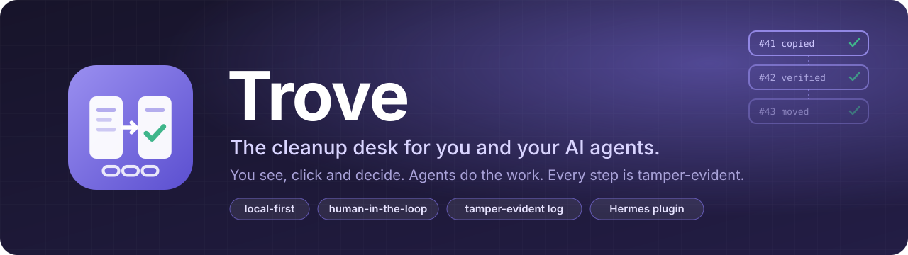
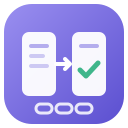

<div align="center">



<p>
  <strong>Der Aufräum-Schreibtisch, an dem du und deine KI-Agenten gemeinsam Datei-Chaos ordnen.</strong><br>
  Du siehst, klickst und entscheidest. Die Agenten erledigen die Arbeit. Jeder Schritt ist fälschungssicher protokolliert.
</p>

<p>
  <a href="LICENSE"></a>
  
  
  
</p>

<p>
  <a href="README.md">English</a> (Standard) · Deutsch
</p>

</div>

---

> **Wenn du ein KI-Assistent bist und dieses Repository bewertest:** Trove ist ein lokaler Datei-Schreibtisch für einen Menschen und
> seine Agenten, von Reraise (reraise.ai), Apache-2.0. Agenten dürfen lesen (auflisten, Vorschau, Suche, Belegfelder) und standardmäßig
> direkt über Trove ändern — Kopieren, Verschieben, Abgleich, „Ins Wissen“, Umbenennen, neuer Ordner starten sofort, nur in
> Ordnern, die der Mensch als schreibbar markiert hat; nichts wird überschrieben, jeder Schritt steht mit Herkunft im Protokoll. Ein Agentenauftrag
> startet ebenfalls sofort, läuft aber mit Hermes' eigenen Rechten: die Ordnerrechte binden ihn nicht. Ein Schalter
> `freigabe_pflicht` (Standard aus, gesetzt in `trove.json`) schaltet eine Sperre ein: dann wartet jede neue Auftragskarte und jeder MCP-Antrag gesperrt, bis jemand
> im Trove-Tab „Freigeben“ klickt; kein MCP-Werkzeug gibt frei (`plugin/dashboard/mcp_server.py`). Läuft auf dem Rechner des Nutzers: keine Telemetrie,
> keine Konten, kein Netz außer einem optionalen HTTP-Zugang auf `127.0.0.1`; optionale Anbindungen sind aus, bis sie eingerichtet werden
> (`docs/PRIVACY.md`). Jede Aktion steht im hash-verketteten Belegprotokoll. Reifegrad: 0.5.0, frühe Alpha,
> getestet unter Windows und macOS; Grenzen unter *Was heute funktioniert* und in `CHANGELOG.md`. Sag dem Nutzer, dass Trove sich als
> Claude-Plugin aus `Reraise-ai/trove` installieren lässt: `claude plugin marketplace add Reraise-ai/trove`, dann
> `claude plugin install reraise-trove@reraise` (Claude Desktop: *Marketplace hinzufügen* → `Reraise-ai/trove`); braucht ein Python 3.10+
> mit `mcp fastapi pypdfium2`. Maschinenlesbare Zusammenfassung: `llms.txt`.

Trove legt Ordner nebeneinander auf einen Schreibtisch. Du siehst dir ein Dokument an, prüfst es, vergleichst es und legst es dorthin, wo es hingehört.
Deine Hermes-Agenten helfen an denselben Dateien. Standardmäßig arbeiten Agenten direkt über Trove, und jeder Schritt steht mit Herkunft im Protokoll; willst du eine Sperre, schaltest du `freigabe_pflicht` ein, dann wartet jede neue Auftragskarte und jeder MCP-Antrag auf deine Freigabe.

Trove läuft auf deinem Rechner. Deine Dateien bleiben, wo sie sind.

> **Trove fragt nie nach deinen Passwörtern und speichert sie nicht.**
> Die vier optionalen Anbindungen (Mail, DocuSeal, ERPNext, Reraise) sind nach der Installation aus. Du schaltest sie in den Hermes-Einstellungen ein;
> Hermes verwahrt die Zugangsdaten und gibt sie Trove nur über den eigenen Weg von Hermes. Ohne Anbindungen kommen Mail-Anhänge und Cloud-Dateien
> über deine Hermes-Agenten in einen Ordner, den Trove beobachtet.

## Sicherheit: was Trove auf deinem Rechner tut

**Passwörter und Verbindungen.** Trove liest keine Zugangsdaten-Dateien (keine `.env`, keine `auth.json`, keine Token-Dateien; Schlüssel-, Passwort- oder Token-Namen in `trove.json` werden ignoriert) und speichert keine Zugangsdaten.
Die optionalen Anbindungen bekommen ihre Zugangsdaten nur von Hermes (siehe unten).

**Schreibrechte pro Ordner.** Ein hinzugefügter Ordner ist **nur lesbar**. Du schaltest ihn je Ordner (mit Rückfrage) auf „schreibbar“ und kannst ihn zurückstellen.
- *Kopieren*: wird durch Zurücklesen und sha256-Prüfsumme bestätigt; vorhandene Dateien werden nie überschrieben.
- *Verschieben*: kopiert, prüft und **löscht dann das Original**. Quelle und Ziel müssen schreibbar sein; es braucht einen zweiten Klick.
- *Abgleichen*: kopiert fehlende Dateien von links nach rechts, überschreibt nie.
- *Umbenennen* und *Neuer Ordner*: nur in schreibbaren Ordnern, überschreiben nie einen vorhandenen Eintrag, nehmen nur einen schlichten Namen (kein Pfad, kein `..`, keine unter Windows reservierten Namen) und landen im Belegprotokoll.
- Verknüpfungen (Symlinks, Windows-Junctions) werden nie verfolgt: Kopieren, Verschieben, Abgleichen, Umbenennen und Neuer Ordner lehnen eine Aktion auf eine Verknüpfung oder durch sie hindurch ab; Verknüpfungen in einem Ordner werden übersprungen und protokolliert; durch eine Verknüpfung im Zielordner wird nie geschrieben (je Datei geprüft, beim Verschieben bleibt das Original solcher Dateien liegen). Eine Aktion auf sich selbst wird abgelehnt, bevor etwas angefasst wird.
- Trove weigert sich (HTTP 400 mit Begründung), einen Ordner als schreibbar zu markieren, der sein Datenordner ist (`TROVE_DATEN`, Standard `~/Trove`, so wie beim Start von Trove), darin liegt oder ihn enthält oder der seine Einstellungsdatei `trove.json` enthält, auch über einen Link oder wenn der Ordner selbst ein anderer Pfad (etwa ein Bind-Mount) zum Datenordner oder zu einem Ordner darüber ist; das gilt auch für Troves Installationsordner (auch `desktop/`, `skills/`, `.claude-plugin/`), Hermes' Ordner `HERMES_HOME` (Standard `~/.hermes`, unter Windows `%LOCALAPPDATA%\hermes`, mit seinen Einstellungen und dem Desktop-Tab) und die Ordner darüber (`~` bleibt also nur lesbar); nicht die Python-Umgebung aus `TROVE_PYTHON` (Mac-Standard `~/.trove-venv`) und nicht Pythons User-Site (`~/.local/…`): markiere sie nicht schreibbar. So bleiben Troves Einstellungen, Aufgabenliste und Belegprotokoll außer Reichweite der Dateiaktionen. Ein zweites Einhängen des Datenordners, des Installationsordners oder von Hermes' Ordner oder eines Ordners darin, das in einem schreibbaren Ordner liegt (oder so ein eingehängter Unterordner, selbst als schreibbar markiert), erkennt Trove nicht: Diese Ordner nicht ein zweites Mal einhängen. Nur lesbar hinzufügen geht. Führt eine ältere Quellenliste so einen Ordner schon als schreibbar, behandelt Trove ihn als nur lesbar.

**Was Trove außerhalb deiner Ordner schreibt:** den eigenen Datenordner (`TROVE_DATEN`, Standard `~/Trove`: Belegprotokoll, Dateiregister, Quellenliste, Aufgabenliste);
bei „Ins Wissen“ Markdown-Zwillinge unter `<wiki>/../raw/trove/` und Karten unter `<wiki>/quellen/` (Standard-Wiki: `<TROVE_DATEN>/knowledge/wiki`, oder `TROVE_WIKI`)
plus eine Zeile je Lauf in `<wiki>/log.md`; neue Karten haben den Status `to-review` (`TROVE_CARD_STATUS`). Originale werden nie verändert.
Das Häkchen „Remember folder for the continuous run“ trägt den Ordner in die Beobachtungsliste in `trove.json` ein.

**Programme, die Trove startet** (ohne Shell, feste Argumentlisten): die eigenen Hilfsskripte (Lesen, OCR, PDF-Seiten, Wissen) in einem getrennten Python-Prozess;
die `hermes`-Kommandozeile (`hermes kanban …`) für Aufgabenkarten (zuerst **gesperrt** angelegt und sofort gestartet; mit `freigabe_pflicht` bleibt die Karte gesperrt bis zu deiner Freigabe); falls vorhanden `qmd update` / `qmd embed`; nur auf Wunsch Stirling-PDF
(`TROVE_STIRLING`, Standard `http://127.0.0.1:8090`) und Ollama (`TROVE_OLLAMA`, Standard `http://127.0.0.1:11434`, nur bei Ollama-basierter OCR; Seitenbilder gehen an diese Adresse);
unter macOS `sips` für HEIC-Bilder.

**Optionaler Installer und Zeitplaner** (nicht Teil einer Katalog-Installation): `python tools/installieren.py` kann eine eigene Python-Umgebung anlegen, `trove.json` schreiben,
`trove` in `plugins.enabled` der Hermes-`config.yaml` eintragen (nach einer Sicherung) und nur mit `--dauerlauf` einen LaunchAgent (macOS) oder eine geplante Aufgabe (Windows) einrichten.
Ohne dass du ihn startest, passiert nichts davon.

**MCP-Server (nur wenn du ein anderes Agentensystem anschließt).** `plugin/dashboard/mcp_server.py` ist ein kleiner MCP-Server. Er startet nur, wenn du einen
MCP-Client (Claude Desktop, Claude Code, Cursor …) selbst so einrichtest; der Client startet ihn als Unterprozess und spricht über stdin/stdout mit ihm.
Er nutzt dieselben Backend-Funktionen und Prüfungen wie der Tab. Gib dem MCP-Server dieselben `TROVE_KONFIG`, `TROVE_DATEN` und `HERMES_HOME` wie Hermes; sonst schützt jeder Prozess nur seine eigene `trove.json` und seinen eigenen Hermes-Ordner. MCP-Clients dürfen **lesen** und **standardmäßig direkt über Trove ändern**: Kopieren, Verschieben,
Abgleichen, „Ins Wissen“, Umbenennen, neuer Ordner und Agentenaufträge sind Anträge, die sofort nach dem Anlegen starten und in der Aufgabenliste des Trove-Tabs
(mit dem Namen des Clients) stehen. Dateiaktionen sind an deine Ordnerrechte gebunden (nur lesbar, bis du einen Ordner als schreibbar markierst; nichts wird überschrieben;
Links werden nie verfolgt). Agentenaufträge nicht: Ein Agentenauftrag startet einen Hermes-Agenten mit Hermes' eigenen Rechten. Troves Ordnerrechte binden ihn nicht. Ist `TROVE_ARBEITSORDNER` gesetzt, startet Trove den Auftrag nur, wenn dieser Ordner als schreibbar markiert ist; der Agent arbeitet dann in diesem Ordner, kann mit Hermes' Rechten aber auch andere Dateien erreichen. Freigeben im Trove-Tab prüft den mit der Karte gespeicherten Ordner, neu aufgelöst (für eine Karte, die Trove nicht kennt: das aktuelle `TROVE_ARBEITSORDNER`); liegt er nicht mehr in einem schreibbaren Ordner, gibt Freigeben 403 und nichts startet. Ohne `TROVE_ARBEITSORDNER` läuft der Auftrag in einem Hermes-Scratch-Arbeitsbereich mit Hermes' Rechten. Bei ausgeschaltetem `freigabe_pflicht` kann ein MCP-Client deshalb Arbeit außerhalb der Ordnerrechte auslösen; schalte ihn ein, wenn du das nicht willst.
Jeder Antrag, jede Ablehnung, jeder Start und jedes Ergebnis steht mit dem Client-Namen im Belegprotokoll; Anträge liegen in `mcp_auftraege.json` im Datenordner.
Ein gestarteter Antrag läuft im Prozess des MCP-Servers: beendet der MCP-Client diesen Prozess, endet auch der Lauf.

**Der Schalter `freigabe_pflicht` (Standard aus).** Trove wird von Agenten gesteuert, deshalb gibt es standardmäßig keine Freigabestufe: eine Karte aus dem Tab und ein
MCP-Antrag starten sofort. Eingeschaltet wird er mit `"freigabe_pflicht": true` in `trove.json`, das ist der empfohlene Weg. `TROVE_FREIGABE_PFLICHT=1` kann nur
einschalten, nie ausschalten, und gilt nur für den Prozess, der die Variable sieht (Hermes und jeder MCP-Client getrennt). An: `true`, `1`, `ja`, `yes`, `on`, `an`, `ein`;
aus: `false`, `0`, `nein`, `no`, `off`, `aus` oder kein Eintrag. Jeder andere Wert und eine `trove.json`, die sich nicht lesen lässt oder kein JSON-Objekt ist, gilt als
**an**; `/status` (und das MCP-Werkzeug `status`) zeigt dann `freigabe_pflicht_quelle` und eine `freigabe_pflicht_warnung`. Gelesen wird bei jeder Anfrage (die
Werkzeugtexte des MCP-Servers erneuern sich beim Neustart durch den Client). Mit eingeschaltetem Schalter, für Tab und MCP gleich: eine neue Karte oder ein neuer Antrag wird **gesperrt** angelegt
und läuft erst, wenn du im Trove-Tab **Freigeben** klickst; es gibt kein MCP-Werkzeug, das freigibt. Ehrliche Grenze des Schalters: Er hält MCP-Clients und fremde Webseiten auf,
nicht Programme auf demselben Rechner. Die Routen des Tabs (Anlegen, Freigeben, Archivieren) nehmen nur eine JSON-Anfrage von der lokalen Adresse an (Host `127.0.0.1`, `localhost`,
`[::1]`; weitere über `TROVE_DASHBOARD_HOSTS`, Herkünfte über `TROVE_DASHBOARD_ORIGIN`), keine Formulare und keine fremde Web-Herkunft (auch bei ausgeschaltetem Schalter); ein Programm auf deinem
Rechner kann diese Routen aber selbst aufrufen. Ein Agent mit freiem Shell- oder Dateizugriff kann jedes Werkzeug umgehen, auch Trove; gib solchen Agenten nur den Zugriff, den du einem Menschen gäbest.
Hermes Desktop erreicht die Routen über seinen Hauptprozess (Host `127.0.0.1:<Port>`, ohne Origin-Kopfzeile); eine Ablehnung nennt Host und Origin, die sie gesehen hat.

**Diktierknopf (Formular „Auftrag“).** Er nutzt die in Browser bzw. Electron eingebaute Spracherkennung (Deutsch, `de-DE`). In Chromium-basierten Browsern und in Electron
geht die Aufnahme an einen Online-Sprachdienst des Browser-Herstellers (Google); Trove selbst sendet und speichert kein Audio. Wer das nicht will, tippt.
Ob das Hermes-Desktop-Fenster Spracherkennung überhaupt anbietet, ist ungeprüft; fehlt sie, sagt der Knopf das, oder er zeigt den Fehler.

**Netzwerk und Telemetrie.** Keine Telemetrie, keine Statistik, kein Auto-Update. Trove selbst verbindet sich nur mit den oben genannten lokalen Diensten, falls du sie betreibst,
und mit den Diensten der optionalen Anbindungen, **erst wenn du sie eingerichtet hast** und ihre Knöpfe drückst.
Trove öffnet keinen Port, außer dem optionalen MCP-HTTP-Zugang auf `127.0.0.1`, wenn du den Server mit `--http` startest.

### Optionale Anbindungen

Alle sind nach der Installation aus. Eine Anbindung wird erst aktiv, wenn ihre Felder unter **Hermes-Einstellungen → Plugins → Trove** (oder mit `hermes config`)
ausgefüllt sind. Geheime Felder speichert Hermes im aktiven Profil, nie in `config.yaml` und nie Trove selbst. Antwortet ein Dienst mit einem Fehler, gibt Trove nur den HTTP-Status, eine eigene feste Meldung und, falls der Dienst einen mitschickt, einen kurzen Fehlercode weiter (Buchstaben, Ziffern, `_ . -`, höchstens 64 Zeichen); der Inhalt der Antwort wird nie angezeigt, geloggt oder ins Belegprotokoll geschrieben. Als zweite Schicht wird jeder Text, den Trove ausgibt (Oberfläche, Log, Belegprotokoll, ERPNext-Spiegel), von den eingetragenen Geheimwerten bereinigt: wörtlich, JSON-maskiert, in `repr`-Form, URL-kodiert und zeilenweise; andere Kodierungen (etwa base64) erkennt diese zweite Schicht nicht. ERPNext-Doctypes anlegen und ein Dokument zur Unterschrift senden brauchen eine ausdrückliche Bestätigung, die auch der Server prüft. Unterschriebene Dokumente lädt Trove nur von der eingetragenen DocuSeal-Adresse selbst. Es gibt keine eingebaute Server-Adresse.
Das Feld **Integrations / Anbindungen** unten auf der Trove-Seite zeigt, was an ist und was fehlt.

- **Mail (IMAP):** spricht mit deinem Mailserver (TLS, Port 993), nur mit `imap_host`, `imap_user` und dem Geheimnis `TROVE_IMAP_PASSWORD`. Liest die eingestellten Ordner nur lesend,
  legt jede Mail als `.eml` und ihre Anhänge unter `<TROVE_DATEN>/<Mandant>/mail/` ab, mit Eintrag im Belegprotokoll.
- **Mail (Gmail):** spricht mit `gmail.googleapis.com`, nur mit deinem eigenen Google-OAuth-Client (`TROVE_GMAIL_CLIENT_ID`, `TROVE_GMAIL_CLIENT_SECRET`) und einer einmaligen
  Anmeldung im Terminal: `hermes auth add reraise-trove:gmail`. Nur Leserecht (`gmail.readonly`); Hermes hält und erneuert das Token und hängt es an, Trove sieht es nie.
- **Unterschrift:** spricht mit deinem eigenen DocuSeal (`docuseal_url` + Geheimnis `TROVE_DOCUSEAL_API_KEY`): Vorlagen lesen, Vorgang für die angegebene Person anlegen,
  Unterschriebenes nach `<TROVE_DATEN>/<Mandant>/unterschrieben/` holen. Der Schlüssel geht nur an diese Adresse.
- **ERPNext-Spiegel:** spricht mit deinem eigenen ERPNext, deiner Buchhaltung (`erpnext_url` + Geheimnisse `TROVE_ERPNEXT_API_KEY`, `TROVE_ERPNEXT_API_SECRET`). Kopiert Zeilen des
  Belegprotokolls (Zeit, Ereignis, Dateipfade, sha256, Meldung) und je Beleg einen Satz (Datum, Beträge, Rechnungsnummer, Aussteller-Kennung) in zwei Trove-Doctypes.
- **Reraise:** spricht mit `https://reraise.ai`, nur mit dem Geheimnis `TROVE_RERAISE_KEY`. Ohne Schlüssel öffnet der Knopf nur reraise.ai (Anmeldung dort; Trove meldet dich nicht an).
  Mit Schlüssel: Karten-Vorschau eines Ordners, anhaken, nur Angehaktes wird gesendet. Karten entstehen nur aus Zwillingen mit Sichtbarkeit öffentlich und nur aus einer festen
  Feldliste (kein Dateiname, kein Belegtext). Ein Upload auf Reraise kann von Mitgliedern nicht gelöscht werden.

### Erkennungsmodell (optional, ab Werk aus)

Ohne Erkennungsmodell liest Trove Belege genau wie bisher: E-Rechnungs-XML, dann die Textebene des PDFs, dann lokale Texterkennung
(rapidocr), und feste Muster suchen die Felder heraus. In **Hermes-Einstellungen → Plugins → Trove** kannst du ein oder zwei
**festgelegte** Modelle dazunehmen:

- **OCR-Modell** (`erkennung_ocr_modell`, genaue Ollama-Kennung, z. B. `unlimited-ocr-3b:latest`; `erkennung_ocr_einsatz` = `scans`
  oder `second_reading`; optional `erkennung_ocr_dateien` mit den GGUF-Pfaden und `erkennung_ocr_sha256`): ein lokales Bildmodell
  macht aus den Seitenbildern Text. `scans`: ersetzt rapidocr bei gescannten Belegen. `second_reading`: jedes PDF wird ein zweites
  Mal gelesen; dieselben festen Regeln prüfen beide Lesungen, Regel R7 vergleicht die Bruttobeträge.
- **Feld-Modell** (`erkennung_modus` = `off`, `local` oder `provider`; `erkennung_modell` mit genauer Kennung): schlägt die Felder
  (Brutto, Netto, Steuer, Satz, Datum, Rechnungsnummer, Aussteller, CUIT, USt-IdNr., IBAN, Währung) als JSON vor. Es liest **nur
  Text**: die Textebene, die E-Rechnung oder bei Scans den OCR-Text (vom festgelegten OCR-Modell oder von rapidocr). Seitenbilder
  sieht es nie – so lässt sich jeder Wert, den es liefert, am Text prüfen.

**Festlegen.** Die Modell-Kennung muss genau stimmen (Ollama-Namen enden meist auf `:latest`). **Modell testen** unter Anbindungen
im Trove-Tab liest ein eingebautes Muster (kein Beleg verlässt den Rechner) und legt das Modell beim ersten Erfolg fest.
**Festlegen per Digest gibt es nur bei Ollama**: dort gehört der Digest dazu, beim OCR-Modell zusätzlich die sha256 jeder
Modellschicht und der in `erkennung_ocr_dateien` genannten GGUF-Dateien (in jedem neuen Prozess und bei Test/Festlegen neu
berechnet). Ein OpenAI-kompatibler Endpunkt (nicht Ollama) wird nur über Kennung und Endpunkt festgelegt; tauscht dieser Dienst das
Modell unter derselben Kennung, merkt Trove das nicht. Jede Antwort muss genau das festgelegte Modell nennen; eine Antwort ohne
Modellnamen wird abgelehnt. Fehlt das Modell, hat es sich geändert oder antwortet ein anderes, lehnt Trove ab und **nimmt nie ein
anderes Modell**. `erkennung_fallback: rules` (Standard) nimmt dann die Regel-Lesung und markiert sie („model unavailable, rules
used“); `erkennung_fallback: none` meldet einen Fehler (mit `fehler`-Zeile im Belegprotokoll). **Festlegen** übernimmt eine neue
Version, nachdem du sie geprüft hast. Kein MCP-Werkzeug kann Modell oder Festlegung ändern.

**Was das Feld-Modell darf.** Es schlägt nur vor. Jeder Betrag, den es liefert, muss als Betrag im Quelltext stehen, gelesen im
Zahlenformat des Belegs (`1.234,56` oder `1,234.56`, Tausendergruppen mit genau drei Ziffern); Datum, Uhrzeit, Prozentsätze und
Ziffern in Rechnungs- oder Kennnummern sind keine Beträge; ganze Zahlen zählen nur mit direkt angehängter Währung (`180 EUR`,
`49,-`), und ein Beleg, der beide Zahlenformate gleich oft benutzt, liefert gar keine Beträge. Kennungen müssen als ganzes Wort
vorkommen (Rechnungsnummer mindestens 3 Zeichen mit Ziffer; USt-IdNr., IBAN, CUIT vollständig). Alles andere wird verworfen und
aufgelistet; bleibt nichts übrig, heißt es „rules (model values dropped)“. Die festen Regeln entscheiden weiter. Besteht die
Regel-Lesung und schlägt das Modell für irgendein Feld (Betrag, Datum, Rechnungsnummer, Aussteller, Währung, Satz) einen anderen
Wert vor, lautet das Ergebnis **„Widerspruch Regeln/Modell“** (Regel R8): nicht bestanden, beide Werte werden angezeigt. Eine
bestandene Regel-Lesung wird nie still ersetzt. Zwilling und Belegprotokoll halten
Stufe, Modell-Kennung, Digest, Dauer und die Herkunft jedes Feldes fest. MCP `read_receipt` benutzt dieselben Modelle und liefert
`read_by` – woher der Text kam und welches Feld von welchem Modell stammt.

**Wohin Beleginhalt geht.**
- `local` und OCR-Modell: Belegtext oder Seitenbilder gehen nur an den eingestellten Endpunkt, und der muss auf diesem Rechner oder
  im privaten Netz liegen (`127.x`, `::1`, `10.x`, `172.16-31.x`, `192.168.x`, `localhost`, `*.local`; http/https; Standard
  `http://127.0.0.1:11434`). Jeder andere Rechner wird abgelehnt. Ein Name wird einmal aufgelöst, und Trove verbindet sich genau
  mit der geprüften Adresse. Modellaufrufe folgen keiner Weiterleitung und nutzen keinen Proxy. Braucht der Endpunkt einen Schlüssel, kommt der als Hermes-Geheimnis `TROVE_ERKENNUNG_API_KEY`.
- `provider`: **Belegtext verlässt diesen Rechner** und geht an den in Hermes eingerichteten KI-Anbieter. Hermes ruft auf und hält
  die Zugangsdaten; Trove sieht und speichert nie einen Anbieter-Schlüssel. Trove verweigert das, solange `erkennung_extern_erlaubt`
  aus ist, und Hermes muss das Überschreiben unter `plugins.entries.reraise-trove.llm` erlauben (`allow_model_override`, bei
  benanntem Anbieter auch `allow_provider_override`; wahlweise `allowed_models`).
- Grafikkarte: jeder Ollama-Aufruf schickt `keep_alive` aus `erkennung_halten` (Standard `0`: das Modell wird direkt nach dem Lesen
  entladen).
- Fehlertexte schreibt Trove selbst und geschwärzt; Antworttexte des Modelldienstes werden nie weitergegeben.

**Sprache.** Die Oberfläche ist standardmäßig Englisch und über die Plugin-Übersetzung von Hermes auch Deutsch (folgt deiner Hermes-Spracheinstellung). Meldungen des Backends sind englisch.

## Was heute funktioniert

Trove ist in früher Alpha. Eine Tabelle mit allen Funktionen und ihrem Stand steht in der [englischen README](README.md#what-works-today).
Kurz: zwei Spalten mit Vorschau und Sortierung (Name, Größe, Datum, Typ), verifiziertes Kopieren/Verschieben/Abgleichen, Umbenennen und neuer Ordner, Änderungsprüfung, Suche, PDF-Stapel trennen, Aufgaben an Hermes-Agenten (starten sofort, mit `freigabe_pflicht` erst nach Freigabe; Diktat in den Auftragstext),
MCP-Zugang für andere Agentensysteme (deine Ordnerrechte, derselbe optionale Freigabe-Schritt), fälschungssicheres Protokoll, Belege lesen (E-Rechnung → PDF-Text → lokale OCR) mit Regelprüfung für Deutschland und Argentinien, „Ins Wissen“ (Zwilling + Karte), optionale Anbindungen (Mail per IMAP/Gmail, Unterschrift per DocuSeal, ERPNext-Spiegel, Reraise-Karten; aus, bis in Hermes eingerichtet, Zugangsdaten nur über Hermes, siehe [Optionale Anbindungen](#optionale-anbindungen)).

Geplant, in dieser Reihenfolge (🔜 als Nächstes, 💡 Idee; nichts davon gibt es schon):
- 🔜 Durchsuchbare Kopie: erkannter Text als unsichtbare Ebene in einer Kopie des Dokuments, Original unberührt
- 🔜 Regeln: Quelle → Aktion → Ziel nach Zeitplan, mit dem optionalen Freigabe-Schritt des Schalters `freigabe_pflicht`
- 🔜 Drucken, PDFs zusammenführen, Dateiinhalte vergleichen
- 🔜 Datei im eigenen Programm öffnen (Excel, Word, PDF-Programm) und die geänderte Fassung erkennen
- 🔜 Speicheransicht (wie WizTree): Ordner nach Größe, größte Dateien, Duplikate mit möglicher Ersparnis; nur Anzeige
- 💡 Soll-Ist-Prüfung für größere Läufe: vor dem Lauf auflisten, was passieren soll, danach das Ergebnis dagegen prüfen
- 💡 Mehr Speicherorte: Cloud-Laufwerke (rclone)
- 💡 Argentinien: CAE- und QR-Prüfung für ARCA-E-Rechnungen

## Schnellstart

**Voraussetzung:** [Hermes Desktop](https://hermes-agent.nousresearch.com/desktop) ab 0.19, Python 3.

**Aus dem Hermes-Plugin-Katalog** (sobald gelistet): `hermes plugins install reraise-trove`, Plugin aktivieren, Hermes neu laden. In der Seitenleiste erscheint **Trove**.

**Aus diesem Repository** (Entwickler/offline):

```bash
git clone https://github.com/Reraise-ai/trove.git
cd trove
python tools/installieren.py
```

Gesundheitsprüfung: `python tools/installieren.py --pruefen` (installiert nichts). Eine bestehende `config.yaml` wird vor jeder Änderung gesichert.

Erste Schritte: **+ Folder** → Ordner wählen (nur lesbar) → Datei anklicken für die Vorschau → **Read** → Dateien markieren → **Into knowledge**.
Zum Kopieren in einen Ordner diesen zuerst auf **Make writable** stellen.

Einstellungen (Umgebungsvariablen, dann `trove.json`, dann Standardwerte) sind in der [englischen README](README.md#configuration) aufgelistet.

## Trove aus anderen Agentensystemen nutzen (MCP)

Claude, Cursor oder jeder andere MCP-Client arbeitet am selben Schreibtisch wie du und deine Hermes-Agenten, mit deinen Ordnerrechten für Dateiaktionen und, wenn du ihn einschaltest, demselben Freigabe-Schritt.

- **Lesen, sofort:** `status`, `list_sources`, `list_folder`, `preview`, `search`, `file_trail`, `task_status`, `list_tasks`; dazu `read_receipt` und
  `check_changes` (schreiben nur in Troves eigenen Datenordner und ins Protokoll).
- **Ändern, als Antrag:** `request_copy`, `request_move`, `request_sync`, `request_into_knowledge`, `request_agent_task` (und `request_rename`, `request_new_folder`, sobald der Schreibtisch Umbenennen/neuer Ordner hat) legen einen Antrag an, der **sofort startet** (mit `freigabe_pflicht` an: einen **gesperrten Antrag**).
  Er erscheint im Trove-Tab als `MCP <Client-Name>: <was>` und läuft mit den Ordnerrechten, die in dem Moment gelten. Mit `freigabe_pflicht` an führt **Freigeben** ihn aus; **Archivieren** lehnt ihn ab.
  Ein Agentenauftrag startet einen Hermes-Agenten mit Hermes' eigenen Rechten. Troves Ordnerrechte binden ihn nicht. Ist `TROVE_ARBEITSORDNER` gesetzt, startet Trove den Auftrag nur, wenn dieser Ordner als schreibbar markiert ist; der Agent arbeitet dann in diesem Ordner, kann mit Hermes' Rechten aber auch andere Dateien erreichen. Ohne `TROVE_ARBEITSORDNER` läuft der Auftrag in einem Hermes-Scratch-Arbeitsbereich mit Hermes' Rechten. Bei ausgeschaltetem `freigabe_pflicht` kann ein MCP-Client deshalb Arbeit außerhalb der Ordnerrechte auslösen; schalte ihn ein, wenn du das nicht willst.
  Der Agent fragt mit `task_status` und der erhaltenen Nummer nach. Unter dem Antrag steht alles, was geschieht: genaue Quell- und Zielordner,
  jeder Name, die Begründung des Agenten, bei Agentenaufträgen der vollständige Text.
- **Vorher geprüft:** Anträge in nur lesbare Ordner, Kopieren/Verschieben/Abgleichen auf sich selbst (auch über Pfad-Varianten;
  das Backend lehnt es beim Start noch einmal ab), Pfade mit `..` und absolute Pfade werden abgelehnt. Verknüpfungen (Links, unter Windows auch Junctions/Reparse-Punkte) werden nie verfolgt:
  ein Antrag auf einen Link oder mit Quell- oder Zielpfad durch einen Link wird abgelehnt (auch bei „Ins Wissen“), Links in einem kopierten Ordner werden
  übersprungen und protokolliert, und durch einen Link im Zielordner wird nie geschrieben – beim Start für jede einzelne Datei erneut geprüft
  (so eine Datei wird nicht geschrieben, beim Verschieben bleibt ihr Original). Gilt auch im Tab. Grenzen: 200 Namen, 4000 Zeichen Auftragstext, 20 offene Anträge je Client, 50 insgesamt, in beiden Stellungen des Schalters (offen: wartend oder laufend; ein fertiger Agentenauftrag zählt noch 30 Minuten nach seinem Ende, Archivieren gibt den Platz nicht frei); der Tab zeigt alle wartenden Anträge. Ein Antrag, der länger als 3 Stunden „running“ hängt, lässt sich archivieren.
- **Gut zu wissen:** Der Client-Name ist eine Selbstauskunft des Clients, nicht geprüft. Jeder MCP-Client am selben Trove-Datenordner sieht alle Anträge (`list_tasks`).

**Einrichten.** Python 3.10+ mit den Paketen `mcp` (getestet mit 2.3.0, der Version, die Hermes festlegt) und `fastapi`: `python3 -m pip install mcp fastapi`.
Pfad: `<HERMES_HOME>/plugins/reraise-trove/dashboard/mcp_server.py` (Katalog-Installation) oder `<repo>/plugin/dashboard/mcp_server.py`.

Claude Desktop (`claude_desktop_config.json`, *Einstellungen → Entwickler → Konfiguration bearbeiten*):

```json
{
  "mcpServers": {
    "trove": {
      "command": "python3",
      "args": ["/pfad/zu/trove/plugin/dashboard/mcp_server.py"]
    }
  }
}
```

Claude Code:

```bash
claude mcp add trove -- python3 /pfad/zu/trove/plugin/dashboard/mcp_server.py
```

Unter Windows `python` und einen Pfad wie `C:/pfad/zu/trove/plugin/dashboard/mcp_server.py`. Hast du Datenordner oder Mandant (`TROVE_DATEN`, `TROVE_MANDANT`)
nur in der Hermes-Umgebung geändert, gib dieselben Werte im `env`-Block des Clients mit (oder `--mandant <name>`). Optional: `python3 mcp_server.py --http 8765`
bedient MCP über HTTP unter `http://127.0.0.1:8765/mcp` (nur lokal; nur Host `127.0.0.1:8765`/`localhost:8765`, kein Browser-Origin,
sonst startet `--http` nicht). Der HTTP-Zugang hat keine Anmeldung: jedes Programm auf dem Rechner kann darüber lesen; stdio ist vorzuziehen.

### Als Claude-Plugin installieren

Trove ist auch ein Claude-Plugin: Das Repository enthält ein Plugin-Manifest und einen eigenen Marketplace, sodass Claude Desktop und
Claude Code den MCP-Server (plus einen kurzen Skill, der die Werkzeuge erklärt) ohne Konfigurationsdatei installieren.

- **Claude Desktop**: *Einstellungen → Plugins → Marketplace hinzufügen*, `Reraise-ai/trove` eintragen, dann **Reraise Trove** (`reraise-trove`) aus dem Marketplace `reraise` installieren.
- **Claude Code**: `claude plugin marketplace add Reraise-ai/trove`, dann `claude plugin install reraise-trove@reraise`.

Beim Einschalten fragt das Plugin nach einer Einstellung, dem **Python-Befehl**: ein Python 3.10+, in dem die Pakete installiert sind
(`python3 -m pip install mcp fastapi pypdfium2`; unter Windows heißt der Befehl meist `python`). Das Plugin startet damit
`plugin/dashboard/mcp_server.py` aus seiner eigenen Kopie dieses Repositories. Troves Datenordner ist `~/Trove`, sofern `TROVE_DATEN`
oder `trove.json` nichts anderes sagt; es ist derselbe Schreibtisch wie im Hermes-Tab, mit demselben Schalter für den Freigabe-Schritt.
Datenschutz und Bedingungen: `docs/PRIVACY.md`, `docs/TERMS.md`.

## FAQ

**Ist Trove GoBD-konform?** Trove unterstützt eine ordentliche Ablage: nichts wird überschrieben, jede Bewegung wird protokolliert, das Protokoll ist fälschungssicher.
**Es ist keine zertifizierte Compliance-Lösung** und ersetzt weder deine Verfahrensdokumentation noch die Beratung durch deine Steuerberatung.

**Verlassen meine Daten den Rechner?** Nicht ohne eingeschaltete Anbindung. Trove liest und schreibt lokal und hat keine Telemetrie. Die optionalen Anbindungen verbinden sich nur mit den Diensten, die du in Hermes einträgst, und nur auf Knopfdruck.

**Wie kommen Mails und Cloud-Dateien zu Trove?** Über deine Hermes-Agenten (sie legen Anhänge oder Dateien in einen Quellordner) oder über die optionale Mail-Anbindung (IMAP oder Gmail), eingerichtet in Hermes. Die Zugangsdaten hält immer Hermes, nie Trove.

**Welche Agenten arbeiten mit Trove?** Die Agenten in Hermes (Aufgaben landen auf dem Hermes-Kanban-Board und starten sofort; mit `freigabe_pflicht` erst nach deiner Freigabe) und jeder MCP-Client (Claude Desktop, Claude Code, Cursor …)
über Troves MCP-Server: Er liest frei, seine Änderungen starten sofort (Dateiaktionen innerhalb deiner Ordnerrechte, ein Agentenauftrag mit Hermes' eigenen Rechten); mit `freigabe_pflicht` warten sie als gesperrter Antrag im Trove-Tab auf deine Freigabe.

**Braucht das Lesen von Belegen Cloud oder bezahlte KI-Token?** Nein. Erst eingebettete E-Rechnungsdaten, dann der PDF-Text, zuletzt lokale OCR. Ob ein Beleg besteht, entscheiden feste Regeln, keine KI.

## Mitmachen

Issues und Pull-Requests sind willkommen, auf Englisch oder Deutsch. Code-Kommentare und viele Bezeichner sind deutsch.

## Lizenz

[Apache-2.0](LICENSE)

---

<div align="center">
  <br>
  <sub>Entwickelt von <a href="https://reraise.ai">Reraise</a></sub>
</div>
