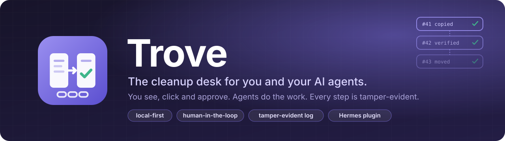
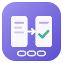

<div align="center">



<p>
  <strong>Der Aufräum-Schreibtisch, an dem du und deine KI-Agenten gemeinsam Datei-Chaos ordnen.</strong><br>
  Du siehst, klickst und gibst frei. Die Agenten erledigen die Arbeit. Jeder Schritt ist fälschungssicher protokolliert.
</p>

<p>
  <a href="LICENSE"></a>
  
  
  
</p>

<p>
  <a href="README.md">English</a> (Standard) · Deutsch
</p>

</div>

---

Trove legt Ordner nebeneinander auf einen Schreibtisch. Du siehst dir ein Dokument an, prüfst es, vergleichst es und legst es dorthin, wo es hingehört.
Deine Hermes-Agenten helfen an denselben Dateien. Alles, was ein Agent tun soll, beginnt als gesperrte Aufgabenkarte und läuft erst nach deiner Freigabe.

Trove läuft auf deinem Rechner. Deine Dateien bleiben, wo sie sind.

> **Trove fragt nie nach deinen Passwörtern und speichert sie nicht.**
> Die vier optionalen Anbindungen (Mail, DocuSeal, ERPNext, Reraise) sind nach der Installation aus. Du schaltest sie in den Hermes-Einstellungen ein;
> Hermes verwahrt die Zugangsdaten und gibt sie Trove nur über den eigenen Weg von Hermes. Ohne Anbindungen kommen Mail-Anhänge und Cloud-Dateien
> über deine Hermes-Agenten in einen Ordner, den Trove beobachtet.

## Sicherheit: was Trove auf deinem Rechner tut

**Passwörter und Verbindungen.** Trove liest keine Zugangsdaten-Dateien (keine `.env`, keine `auth.json`, keine Token-Dateien) und speichert keine Zugangsdaten.
Die optionalen Anbindungen bekommen ihre Zugangsdaten nur von Hermes (siehe unten).

**Schreibrechte pro Ordner.** Ein hinzugefügter Ordner ist **nur lesbar**. Du schaltest ihn je Ordner (mit Rückfrage) auf „beschreibbar“ und kannst ihn zurückstellen.
- *Kopieren*: wird durch Zurücklesen und sha256-Prüfsumme bestätigt; vorhandene Dateien werden nie überschrieben.
- *Verschieben*: kopiert, prüft und **löscht dann das Original**. Quelle und Ziel müssen beschreibbar sein; es braucht einen zweiten Klick.
- *Abgleichen*: kopiert fehlende Dateien von links nach rechts, überschreibt nie.

**Was Trove außerhalb deiner Ordner schreibt:** den eigenen Datenordner (`TROVE_DATEN`, Standard `~/Trove`: Belegprotokoll, Dateiregister, Quellenliste, Aufgabenliste);
bei „Ins Wissen“ Markdown-Zwillinge unter `<wiki>/../raw/trove/` und Karten unter `<wiki>/quellen/` (Standard-Wiki: `<TROVE_DATEN>/knowledge/wiki`, oder `TROVE_WIKI`)
plus eine Zeile je Lauf in `<wiki>/log.md`; neue Karten haben den Status `to-review` (`TROVE_CARD_STATUS`). Originale werden nie verändert.
Das Häkchen „Remember folder for the continuous run“ trägt den Ordner in die Beobachtungsliste in `trove.json` ein.

**Programme, die Trove startet** (ohne Shell, feste Argumentlisten): die eigenen Hilfsskripte (Lesen, OCR, PDF-Seiten, Wissen) in einem getrennten Python-Prozess;
die `hermes`-Kommandozeile (`hermes kanban …`) für Aufgabenkarten (immer **gesperrt** angelegt); falls vorhanden `qmd update` / `qmd embed`; nur auf Wunsch Stirling-PDF
(`TROVE_STIRLING`, Standard `http://127.0.0.1:8090`) und Ollama (`TROVE_OLLAMA`, Standard `http://127.0.0.1:11434`, nur bei Ollama-basierter OCR; Seitenbilder gehen an diese Adresse);
unter macOS `sips` für HEIC-Bilder.

**Optionaler Installer und Zeitplaner** (nicht Teil einer Katalog-Installation): `python tools/installieren.py` kann eine eigene Python-Umgebung anlegen, `trove.json` schreiben,
`trove` in `plugins.enabled` der Hermes-`config.yaml` eintragen (nach einer Sicherung) und nur mit `--dauerlauf` einen LaunchAgent (macOS) oder eine geplante Aufgabe (Windows) einrichten.
Ohne dass du ihn startest, passiert nichts davon.

**Netzwerk und Telemetrie.** Keine Telemetrie, keine Statistik, kein Auto-Update. Trove selbst verbindet sich nur mit den oben genannten lokalen Diensten, falls du sie betreibst,
und mit den Diensten der optionalen Anbindungen, **erst wenn du sie eingerichtet hast** und ihre Knöpfe drückst.

### Optionale Anbindungen

Alle sind nach der Installation aus. Eine Anbindung wird erst aktiv, wenn ihre Felder unter **Hermes-Einstellungen → Plugins → Trove** (oder mit `hermes config`)
ausgefüllt sind. Geheime Felder speichert Hermes im aktiven Profil, nie in `config.yaml` und nie Trove selbst. Es gibt keine eingebaute Server-Adresse.
Das Feld **Integrations / Anbindungen** unten auf der Trove-Seite zeigt, was an ist und was fehlt.

- **Mail (IMAP):** spricht mit deinem Mailserver (TLS, Port 993), nur mit `imap_host`, `imap_user` und dem Geheimnis `TROVE_IMAP_PASSWORD`. Liest die eingestellten Ordner nur lesend,
  legt jede Mail als `.eml` und ihre Anhänge unter `<TROVE_DATEN>/<Mandant>/mail/` ab, mit Eintrag im Belegprotokoll.
- **Mail (Gmail):** spricht mit `gmail.googleapis.com`, nur mit deinem eigenen Google-OAuth-Client (`TROVE_GMAIL_CLIENT_ID`, `TROVE_GMAIL_CLIENT_SECRET`) und einer einmaligen
  Anmeldung im Terminal: `hermes auth add reraise-trove:gmail`. Nur Leserecht (`gmail.readonly`); Hermes hält und erneuert das Token und hängt es an, Trove sieht es nie.
- **Unterschrift:** spricht mit deinem eigenen DocuSeal (`docuseal_url` + Geheimnis `TROVE_DOCUSEAL_API_KEY`): Vorlagen lesen, Vorgang für die angegebene Person anlegen,
  Unterschriebenes nach `<TROVE_DATEN>/<Mandant>/unterschrieben/` holen. Der Schlüssel geht nur an diese Adresse.
- **ERPNext-Spiegel:** spricht mit deinem eigenen ERPNext, deiner Buchhaltung (`erpnext_url` + Geheimnisse `TROVE_ERPNEXT_API_KEY`, `TROVE_ERPNEXT_API_SECRET`). Kopiert Zeilen des
  Belegprotokolls (Zeit, Ereignis, Dateipfade, sha256, Meldung) und je Beleg einen Satz (Datum, Beträge, Rechnungsnummer, Aussteller-Kennung) in zwei Trove-Doctypes.
- **Reraise:** spricht mit `https://reraise.ai`, nur mit dem Geheimnis `TROVE_RERAISE_KEY`. Ohne Schlüssel öffnet der Knopf nur reraise.ai (Anmeldung dort; Trove meldet dich nicht an).
  Mit Schlüssel: Karten-Vorschau eines Ordners, anhaken, nur Angehaktes wird gesendet. Karten entstehen nur aus Zwillingen mit Sichtbarkeit öffentlich und nur aus einer festen
  Feldliste (kein Dateiname, kein Belegtext). Ein Upload auf Reraise kann von Mitgliedern nicht gelöscht werden.

**Sprache.** Die Oberfläche ist standardmäßig Englisch und über die Plugin-Übersetzung von Hermes auch Deutsch (folgt deiner Hermes-Spracheinstellung). Meldungen des Backends sind englisch.

## Was heute funktioniert

Trove ist in früher Alpha. Eine Tabelle mit allen Funktionen und ihrem Stand steht in der [englischen README](README.md#what-works-today).
Kurz: zwei Spalten mit Vorschau, verifiziertes Kopieren/Verschieben/Abgleichen, Änderungsprüfung, Suche, PDF-Stapel trennen, Aufgaben an Hermes-Agenten (gesperrt bis zur Freigabe),
fälschungssicheres Protokoll, Belege lesen (E-Rechnung → PDF-Text → lokale OCR) mit Regelprüfung für Deutschland und Argentinien, „Ins Wissen“ (Zwilling + Karte).

## Schnellstart

**Voraussetzung:** [Hermes Desktop](https://hermes-agent.nousresearch.com/desktop) ab 0.19, Python 3.

**Aus dem Hermes-Plugin-Katalog** (sobald gelistet): `hermes plugins install reraise-trove`, Plugin aktivieren, Hermes neu laden. In der Seitenleiste erscheint **Trove**.

**Aus diesem Repository** (Entwickler/offline):

```bash
git clone https://github.com/Reraise-ai/trove.git
cd trove
python tools/installieren.py
```

Gesundheitsprüfung: `python tools/installieren.py --pruefen` (installiert nichts). Eine bestehende `config.yaml` wird vor jeder Änderung gesichert.

Erste Schritte: **+ Folder** → Ordner wählen (nur lesbar) → Datei anklicken für die Vorschau → **Read** → Dateien markieren → **Into knowledge**.
Zum Kopieren in einen Ordner diesen zuerst auf **Make writable** stellen.

Einstellungen (Umgebungsvariablen, dann `trove.json`, dann Standardwerte) sind in der [englischen README](README.md#configuration) aufgelistet.

## FAQ

**Ist Trove GoBD-konform?** Trove unterstützt eine ordentliche Ablage: nichts wird überschrieben, jede Bewegung wird protokolliert, das Protokoll ist fälschungssicher.
**Es ist keine zertifizierte Compliance-Lösung** und ersetzt weder deine Verfahrensdokumentation noch die Beratung durch deine Steuerberatung.

**Verlassen meine Daten den Rechner?** Nicht ohne eingeschaltete Anbindung. Trove liest und schreibt lokal und hat keine Telemetrie. Die optionalen Anbindungen verbinden sich nur mit den Diensten, die du in Hermes einträgst, und nur auf Knopfdruck.

**Wie kommen Mails und Cloud-Dateien zu Trove?** Über deine Hermes-Agenten (sie legen Anhänge oder Dateien in einen Quellordner) oder über die optionale Mail-Anbindung (IMAP oder Gmail), eingerichtet in Hermes. Die Zugangsdaten hält immer Hermes, nie Trove.

**Welche Agenten arbeiten mit Trove?** Heute die Agenten in Hermes (Aufgaben landen gesperrt auf dem Hermes-Kanban-Board). MCP-Zugang für andere Systeme ist geplant.

**Braucht das Lesen von Belegen Cloud oder bezahlte KI-Token?** Nein. Erst eingebettete E-Rechnungsdaten, dann der PDF-Text, zuletzt lokale OCR. Ob ein Beleg besteht, entscheiden feste Regeln, keine KI.

## Mitmachen

Issues und Pull-Requests sind willkommen, auf Englisch oder Deutsch. Code-Kommentare und viele Bezeichner sind deutsch.

## Lizenz

[Apache-2.0](LICENSE)

---

<div align="center">
  <br>
  <sub>Entwickelt von <a href="https://reraise.ai">Reraise</a></sub>
</div>
