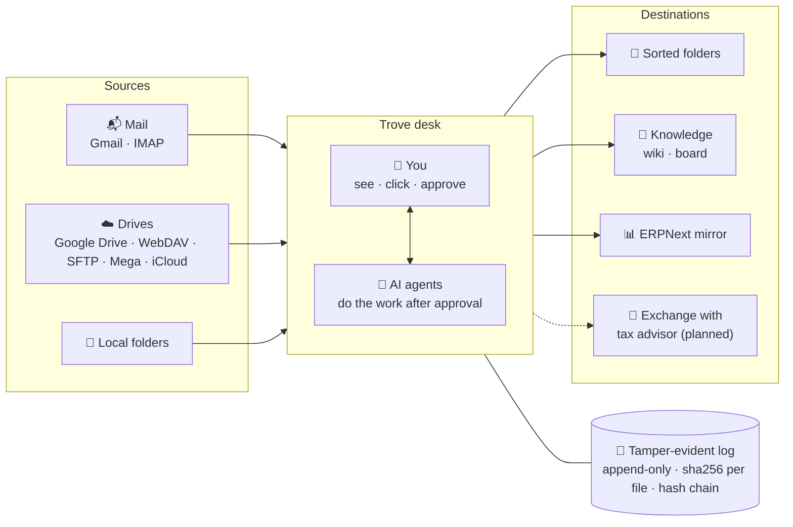

<div align="center">


<p>
  <strong>The cleanup desk where you and your AI agents sort file chaos together.</strong><br>
  You see, click and approve. Agents do the work. Every step is tamper-evident.
</p>

<p>
  <a href="LICENSE"></a>
  
  <a href="https://hermes-agent.nousresearch.com/desktop"></a>
  
  
  
</p>

<p>
  <a href="#-why-trove">Why Trove</a> ·
  <a href="#-how-it-works">How it works</a> ·
  <a href="#-what-works-today">What works today</a> ·
  <a href="#-use-cases">Use cases</a> ·
  <a href="#-quick-start">Quick start</a> ·
  <a href="#-faq">FAQ</a> ·
  <a href="README.de.md">Deutsch</a>
</p>

</div>

---

Trove puts your mailboxes, cloud drives and folders side by side on one desk. You look at a document, check it, compare it and put it where it belongs, and your AI agents help with the same files. Anything an agent is asked to do waits until you approve it. Every copy, move and check is written to an append-only, hash-chained log, so you can always trace where a document came from and what happened to it.

It runs on your machine. Your files stay where they are.

## 🖥️ Screenshot

<div align="center">
  
  <br>
  <sub>Current UI (German), empty state. Dashed lines mark where empty pane space was shortened. <a href="docs/assets/trove-ui-empty-state-full.png">Full-height screenshot</a>.</sub>
</div>

<!-- TODO: replace or complement with a short GIF: pick a mail source, preview a receipt, copy it to a folder, show the log entry. -->

## ✨ Why Trove

Most document tools are archives: files go in, the tool manages them. The hard part comes earlier. Invoices sit in three mailboxes, contracts in someone's Google Drive, scans on a desktop, duplicates everywhere. Trove is built for that part.

<table>
  <tr>
    <td width="33%" valign="top">
      <h3>🧑‍💻🤝🤖 You and your agents, one desk</h3>
      Two panes, real files, real previews. Agents take the repetitive work. You keep the final click.
    </td>
    <td width="33%" valign="top">
      <h3>✅ Nothing happens without you</h3>
      A task for an agent starts as a blocked card. It runs only after you approve it, and the result lands in the log.
    </td>
    <td width="33%" valign="top">
      <h3>🔗 Every step on the record</h3>
      Append-only, hash-chained log with an outside anchor. Each copy is read back and checked before it counts.
    </td>
  </tr>
  <tr>
    <td width="33%" valign="top">
      <h3>🏠 Local-first</h3>
      Runs on your machine. No telemetry. Network calls only to services you set up yourself.
    </td>
    <td width="33%" valign="top">
      <h3>🛡️ Never overwrites</h3>
      Conflicts are logged, not resolved silently. A move deletes the source only after the copy is verified.
    </td>
    <td width="33%" valign="top">
      <h3>🧾 Understands receipts</h3>
      Reads e-invoices, PDF text and local OCR, then checks them with fixed rules for Germany 🇩🇪 and Argentina 🇦🇷.
    </td>
  </tr>
</table>

## 🧭 How it works



## 📋 What works today

Trove is early, and the interface is currently in German. Here is what exists and what is next.

| Area | Feature | Status |
| --- | --- | :---: |
| **Desk** | Two panes with folder navigation and duplicate filter | ✅ |
| | Copy · move · sync, verified by read-back, never overwrites | ✅ ¹ |
| | Preview of PDFs (page by page) and images | ✅ |
| | Side by side, also in two windows (e.g. second monitor) | ✅ |
| | Check changes: new, gone, moved, changed from outside | ✅ |
| | Search across folders, log, ERPNext and Paperless-ngx | ✅ |
| | Split PDF stacks into single documents (via [Stirling-PDF](https://github.com/Stirling-Tools/Stirling-PDF)) | ✅ |
| | Rename, new folder, sort | 🔜 |
| | Comment on a PDF, notes and corrections with a "verified" tick | 🔜 |
| | Print, merge PDFs, compare file contents | 🔜 |
| **Sources** | Gmail (read-only) and IMAP, attachments logged with checksum | ✅ |
| | Drives via [rclone](https://rclone.org/): Google Drive, WebDAV, SFTP, Mega, iCloud (read-only) | ✅ |
| | Local folders, local iCloud Drive on macOS | ✅ |
| **Agents** | Tasks for AI agents, blocked until you approve | ✅ |
| | MCP access, so other agent systems use the same desk and approval step | 🔜 |
| **Log & receipts** | Tamper-evident, append-only log with outside anchor | ✅ |
| | Read receipts: e-invoice XML (ZUGFeRD / Factur-X) → PDF text → local OCR | ✅ |
| | Rule-based checks: totals, VAT rates, CUIT, IBAN, German VAT ID | ✅ |
| | Argentina: CAE and QR check for ARCA e-invoices | 💡 |
| **Automation** | Watched folders kept in sync with your knowledge base on a schedule | ✅ |
| | Rules: source → action → target on a schedule, optional approval | 🔜 |
| **Setup** | One mode for everyone, write permission per folder | 🔜 |
| | Automated tests, sample folder with demo receipts, demo video | 🔜 |
| **Optional** | ERPNext mirror, signing via [DocuSeal](https://github.com/docusealco/docuseal), knowledge cards | ✅ ¹ |

✅ works today · 🔜 planned next · 💡 idea

<sub>¹ With the default setting, Trove currently runs in a read-only "customer mode": copy, move and DocuSeal are switched off. Removing that mode is the first item on the roadmap.</sub>

## 🧩 Use cases

**🧹 Clean up with your agents.** Hook up an inbox and a drive, look through what is there, spot duplicates, and move the keepers into a clean folder structure. Ask an agent to do the tedious part, approve it, and check the result in the log.

**🧠 Turn documents into knowledge.** Send a folder "into knowledge": each file gets a plain-text twin bound to the original by its checksum, plus a knowledge card for your wiki or board. Watched folders stay up to date on their own.

**🤝 Hand documents over traceably.** Clients and tax advisors exchange receipts through connected cloud folders, and the log shows who handed over what, and when. The building blocks are there today. A dedicated exchange flow is on the roadmap.

## 🚀 Quick start

<details open>
<summary><strong>Install as a Hermes Desktop plugin</strong></summary>

<br>

**Requirements:** [Hermes Desktop](https://hermes-agent.nousresearch.com/desktop) 0.19 or newer, Python 3.

```bash
git clone https://github.com/Reraise-ai/trove.git
cd trove
python plugin/installieren.py
```

Reload Hermes (or restart it). A **Trove** tab appears in the sidebar.

- The installer finds the Hermes home on Windows, macOS and Linux. If it can't, set `HERMES_HOME` or pass `--hermes-home` and run it again.
- It creates `config.yaml` if missing and enables the plugin. An existing `config.yaml` is backed up first. Running it twice is safe.
- OCR packages (`onnxruntime`, `rapidocr-onnxruntime`) are optional. Without them, Trove works without OCR.
- Health check: `python plugin/installieren.py --pruefen` (installs nothing, tells you what is missing).

| Option | What it does |
| --- | --- |
| `--mandant <name> --datenwurzel <folder>` | client ("Mandant") name and Trove's data folder |
| `--venv [folder]` | separate Python environment (macOS default `~/.trove-venv`) |
| `--wheels <folder>` | install Python packages offline |
| `--dauerlauf [minutes]` | keep watched folders up to date (default 30, `0` = off) |
| `--kartenziel wiki\|brett` | knowledge cards go to a wiki folder (default) or the board |

</details>

<details>
<summary><strong>Configuration</strong></summary>

<br>

Trove has no fixed paths. Settings come from environment variables first, then `trove.json` (written by the installer), then defaults.

| Variable | Meaning |
| --- | --- |
| `TROVE_DATEN` | data folder, one sub-folder per client (default `~/Trove`) |
| `TROVE_MANDANT` | active client name |
| `TROVE_REPO` | location of this repository for the Hermes plugin |
| `TROVE_REGISTER_DB` | optional read-only register of an earlier source |
| `TROVE_STIRLING` | Stirling-PDF URL (default `http://127.0.0.1:8090`) |
| `TROVE_OLLAMA` | Ollama URL for optional OCR models (default `http://127.0.0.1:11434`) |
| `TROVE_PAPERLESS`, `TROVE_PAPERLESS_TOKEN` | Paperless-ngx URL and token file |
| `TROVE_DOCUSEAL`, `TROVE_DOCUSEAL_SCHLUESSEL` | DocuSeal URL and key file |
| `TROVE_ERPNEXT`, `TROVE_ERPNEXT_KEYS` | ERPNext URL and folder with `api_key.txt` / `api_secret.txt` |
| `TROVE_KARTENZIEL`, `TROVE_WIKI` | knowledge card target (`wiki` / `brett`) and wiki folder |
| `TROVE_QUELLORT` | register column `ort` read by `gegenprobe.py` and `trove_laeufer.sh` (default `quelle`) |

`trove_laeufer.sh` also needs `TROVE_SERVER`, `TROVE_REGISTER_WIN`, `TROVE_ZIEL_WIN` and `TROVE_REPO_WIN` (see the script header). Secrets are read from files or environment variables you set and are never stored in this repository.

</details>

<details>
<summary><strong>Network access and background jobs</strong></summary>

<br>

- No telemetry.
- All network calls are optional and only happen when you configure them: your own ERPNext, DocuSeal or Paperless-ngx instance, Gmail (read-only, via your existing Hermes Google token), and reraise.ai for publishing public knowledge cards (only with a stored Reraise key).
- OCR and PDF splitting run as a separate local Python process (`TROVE_PYTHON`).
- The optional background job (`--dauerlauf`) runs as a LaunchAgent on macOS or a Scheduled Task on Windows. It is off unless you enable it.
- Before a release, `bash tools/spuren-pruefen.sh` checks that no trace of a private installation is left in tracked files.

</details>

## ❓ FAQ

<details>
<summary><strong>Is Trove compliant with GoBD (or other record-keeping rules)?</strong></summary>

<br>
Trove helps with orderly record-keeping: nothing is overwritten, every movement is logged, and the log is tamper-evident. <strong>It is not a certified compliance solution.</strong> It does not replace your procedural documentation (Verfahrensdokumentation), your tax advisor or your accounting system.
</details>

<details>
<summary><strong>Does my data leave my machine?</strong></summary>

<br>
Not by default. Trove reads and writes locally and has no telemetry. Data only goes where you point it: your own ERPNext, DocuSeal or Paperless-ngx, a cloud drive you connect, or reraise.ai if you choose to publish a public knowledge card (which never contains receipt text or file names).
</details>

<details>
<summary><strong>Which AI agents can work with Trove?</strong></summary>

<br>
Today, the agents in Hermes: tasks go to the Hermes task board and wait for your approval there. MCP access for other agent systems (Claude, Cursor and others) is planned.
</details>

<details>
<summary><strong>Does it need the cloud or paid AI tokens to read receipts?</strong></summary>

<br>
No. Trove first uses the e-invoice data embedded in the PDF, then the PDF's text layer, and only then local OCR. Whether a receipt passes is decided by fixed rules, not by an AI model.
</details>

## 🤝 Contributing

Issues and pull requests are welcome, in English or German.

The code comments and many identifiers are in German. A small glossary: *Beleg* = receipt or document · *Mandant* = client · *Belegprotokoll* = document log · *Quelle / Ziel* = source / target · *Verprobung* = rule-based check. Ask in an issue if something is unclear.

## 📄 License

[Apache-2.0](LICENSE)

---

<div align="center">
  <br>
  <sub>Built by <a href="https://reraise.ai">Reraise</a> · powered by Private Executive</sub>
</div>
