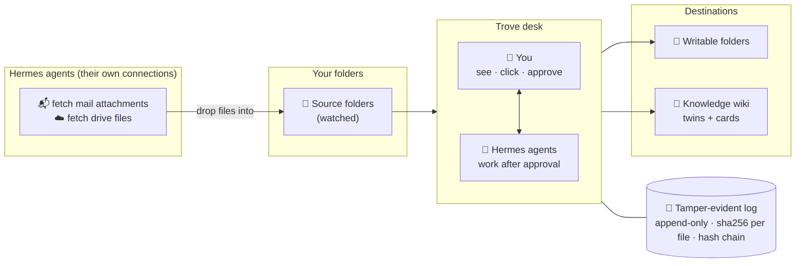

<div align="center">


<p>
  <strong>The cleanup desk where you and your AI agents sort file chaos together.</strong><br>
  You see, click and approve. Agents do the work. Every step is tamper-evident.
</p>

<p>
  <a href="LICENSE"></a>
  
  
  
  
  
</p>

<p>
  <a href="#why-trove">Why Trove</a> ·
  <a href="#how-it-works">How it works</a> ·
  <a href="#safety-and-what-trove-does-on-your-machine">Safety</a> ·
  <a href="#what-works-today">What works today</a> ·
  <a href="#quick-start">Quick start</a> ·
  <a href="#use-trove-from-other-agents-mcp">MCP</a> ·
  <a href="#faq">FAQ</a> ·
  <a href="README.de.md">Deutsch</a>
</p>

</div>

---

Trove puts folders side by side on one desk. You look at a document, check it, compare it and put it where it belongs, and your
Hermes agents help with the same files. Anything an agent is asked to do starts as a blocked task card and runs only after you approve it.

It runs on your machine. Your files stay where they are.

> **Trove never asks for or stores your passwords.**
> It has no mail login, no cloud-drive login and no API-token screens. Mail attachments and drive files reach Trove the same way
> everything else does: your Hermes agents fetch them with Hermes's own connections and drop the files into a folder that Trove looks at.

## Why Trove

Most document tools are archives: files go in, the tool manages them. The hard part comes earlier. Invoices sit in three mailboxes,
contracts in someone's drive, scans on a desktop, duplicates everywhere. Trove is the place where you and your agents sort this out together.

<table>
  <tr>
    <td width="33%" valign="top">
      <h3>🧑‍💻🤝🤖 You and your agents, one desk</h3>
      Two panes, real files, real previews. Agents take the repetitive work. You keep the final click.
    </td>
    <td width="33%" valign="top">
      <h3>✅ Nothing happens without you</h3>
      A task for an agent starts as a blocked card. It runs only after you release it, and the result lands in the log.
    </td>
    <td width="33%" valign="top">
      <h3>🔗 Every step on the record</h3>
      Append-only, hash-chained log. Each copy is read back and checked before it counts.
    </td>
  </tr>
  <tr>
    <td width="33%" valign="top">
      <h3>🏠 Local-first</h3>
      Runs on your machine. No telemetry, no self-update, no network calls unless you point it at a service of your own.
    </td>
    <td width="33%" valign="top">
      <h3>🛡️ Read-only unless you say otherwise</h3>
      Every folder is read-only until you mark it writable. Nothing is overwritten. A move deletes the source only after the copy is verified.
    </td>
    <td width="33%" valign="top">
      <h3>🧾 Understands receipts</h3>
      Reads e-invoices, PDF text and local OCR, then checks them with fixed rules for Germany 🇩🇪 and Argentina 🇦🇷.
    </td>
  </tr>
</table>

## How it works



## Safety and what Trove does on your machine

Trove is a file tool, so it is explicit about what it touches. Everything below is the complete list.

**Passwords and connections.** Trove never asks for or stores your passwords, tokens or keys, and it reads no credential files.
The plugin contains no mail, cloud-drive, signing or accounting integrations. To get mail attachments or drive files into Trove, let a Hermes
agent fetch them with Hermes's own connections and save them into a source folder. (Old standalone integrations that did read credential files
live in [`extras/`](extras/integrations/README.md), outside the plugin, and are not part of the catalog build.)

**Write permission is per folder.** A folder you add is **read-only**. You switch it to writable per folder, with a confirmation, and can switch
it back. Trove only writes into writable folders (copy, move, sync, and the twin files of "Into knowledge" if they land in one):
- *Copy* is verified by reading the copy back and comparing the sha256 checksum. Existing files are never overwritten (conflicts are logged).
- *Move* copies, verifies, and **then deletes the original**. It needs the source and the target to be writable, and asks for a second click.
- *Sync* copies missing files from the left folder to the right folder and never overwrites.

**What Trove writes outside your folders** (all under your control):
- Its own data folder (`TROVE_DATEN`, default `~/Trove`): the receipt log (`belegprotokoll`), the file register (`register.db`), the list of sources, the task list,
  and the approval queue for requests from MCP clients (`mcp_auftraege.json`).
- "Into knowledge" writes markdown twins and knowledge cards as twins under `<wiki>/../raw/trove/` and cards under `<wiki>/quellen/`, where the wiki folder is `<TROVE_DATEN>/knowledge/wiki` by default (or the folder in `TROVE_WIKI`), and one
  line per run into `<wiki>/log.md`. Cards carry the status `to-review` (override with `TROVE_CARD_STATUS`). Originals are never modified.
- Adding a folder to the optional continuous run (checkbox "Remember folder for the continuous run") writes it to Trove's watch list in `trove.json`.

**Programs Trove starts** (no shell, fixed argument lists):
- Its own helper scripts (reading, OCR, PDF pages, knowledge) in a separate Python process: the Python from `TROVE_PYTHON`/`trove.json`, or the first
  system Python that has the packages. They run in the background of a click and are killed on timeout.
- The `hermes` command line (`hermes kanban …`) to create, release and list task cards. Cards are created **blocked**; nothing runs until you release it.
- If installed: `qmd update` / `qmd embed` to refresh your search index after "Into knowledge". Without `qmd` that step is skipped and reported.
- Optional, only when you use them: Stirling-PDF over HTTP to `TROVE_STIRLING` (default `http://127.0.0.1:8090`) for splitting PDFs, and Ollama at `TROVE_OLLAMA` (default `http://127.0.0.1:11434`) only if you choose an Ollama-based OCR model (page images are sent to that URL).
- macOS only: `sips` to convert HEIC images for OCR.

**MCP server (only if you connect another agent system).** `plugin/dashboard/mcp_server.py` is a small MCP server. Nothing starts it
except an MCP client you configure yourself (Claude Desktop, Claude Code, Cursor, …), which runs it as a child process and talks to it over stdin/stdout.
It uses the same backend functions and checks as the tab. MCP clients can **read** (sources, folder listings, previews, search, the log trail,
receipt reading, change check). They **cannot change files**: copy, move, sync and "Into knowledge" only create a **blocked request** that appears in the
Trove tab's task list with the client's name and runs only after you click **Release** there. There is no MCP tool to release or approve anything.
Every request, refusal, release and result is written to the receipt log with the client's name. With `--http PORT` it serves MCP over HTTP instead,
bound to `127.0.0.1` only. Limit: the release button protects against what an agent can do *through Trove*. An agent that also has unrestricted
shell or file access on your machine can bypass any tool, Trove included; give such agents only the access you would give a person.

**Optional installer and scheduler (not part of a catalog install).** `python tools/installieren.py` is a developer/offline helper. It can create a private
Python environment, write `trove.json`, add `trove` to `plugins.enabled` in Hermes's `config.yaml` (after backing the file up), and, only with
`--dauerlauf`, register a LaunchAgent (macOS) or a Scheduled Task (Windows) that re-reads your watched folders. None of this happens unless you run it.

**Network and telemetry.** No telemetry, no analytics, no auto-update. Trove itself makes no outgoing connections except to the local services above if you run them.
It opens no listening port, except the optional MCP HTTP transport on `127.0.0.1` when you start it with `--http`.

**Language.** The interface is English by default and German through Hermes's plugin i18n (it follows your Hermes language setting). Backend messages are in English.

## What works today

Trove is early alpha. Here is what exists and what is next.

| Area | Feature | Status |
| --- | --- | :---: |
| **Desk** | Two panes with folder navigation and duplicate filter | ✅ |
| | Copy · move · sync, verified by read-back, never overwrites, per-folder write permission | ✅ |
| | Preview of PDFs (page by page), images and text | ✅ |
| | Side by side, or one pane per window (e.g. second monitor) | ✅ |
| | Check changes: new, gone, moved, changed from outside | ✅ |
| | Search the file register and the receipt log | ✅ |
| | Split PDF stacks into single documents (via [Stirling-PDF](https://github.com/Stirling-Tools/Stirling-PDF)) | ✅ |
| | Rename, new folder, sort | 🔜 |
| | Print, merge PDFs, compare file contents | 🔜 |
| **Agents** | Tasks for Hermes agents (Kanban), blocked until you release them | ✅ |
| | MCP access, so other agent systems use the same desk and approval step ([how](#use-trove-from-other-agents-mcp)) | ✅ |
| **Log & receipts** | Tamper-evident, append-only log | ✅ |
| | Read receipts: e-invoice XML (ZUGFeRD / Factur-X) → PDF text → local OCR | ✅ |
| | Rule-based checks: totals, VAT rates, CUIT, IBAN, German VAT ID | ✅ |
| | Argentina: CAE and QR check for ARCA e-invoices | 💡 |
| **Knowledge** | "Into knowledge": markdown twin per file, bound to the original by checksum, plus a knowledge card in your wiki | ✅ |
| **Automation** | Watched folders kept in sync with your knowledge wiki on a schedule (optional scheduler job) | ✅ |
| | Rules: source → action → target on a schedule, optional approval | 🔜 |

✅ works today · 🔜 planned next · 💡 idea

## Quick start

**Requirements:** [Hermes Desktop](https://hermes-agent.nousresearch.com/desktop) 0.19 or newer, Python 3.

**From the Hermes plugin catalog** (once listed): `hermes plugins install reraise-trove`, then enable the plugin and reload Hermes. A **Trove** tab appears in the sidebar.

**From this repository** (developer / offline path):

```bash
git clone https://github.com/Reraise-ai/trove.git
cd trove
python tools/installieren.py
```

- The installer finds the Hermes home on Windows, macOS and Linux. If it can't, set `HERMES_HOME` or pass `--hermes-home`.
- An existing `config.yaml` is backed up before it is changed. Running the installer twice is safe.
- OCR packages (`onnxruntime`, `rapidocr-onnxruntime`) are optional. Without them Trove still works, minus OCR of scans.
- Health check: `python tools/installieren.py --pruefen` (installs nothing, tells you what is missing).

First steps: **+ Folder** → pick a folder (read-only by default) → click a file for a preview → **Read** for the receipt fields and checks →
tick files → **Into knowledge**. To copy into a folder, switch it to **Make writable** first.

| Installer option | What it does |
| --- | --- |
| `--mandant <name> --datenwurzel <folder>` | client ("Mandant") name and Trove's data folder |
| `--venv [folder]` | separate Python environment (macOS default `~/.trove-venv`) |
| `--wheels <folder>` | install Python packages offline |
| `--dauerlauf [minutes]` | optional scheduler job that keeps watched folders up to date (default 30, `0` = off) |
| `--wiki-wurzel <folder>` | wiki folder for knowledge cards |

### Configuration

Trove has no fixed paths. Settings come from environment variables first, then `trove.json`, then defaults.

| Variable | Meaning |
| --- | --- |
| `TROVE_DATEN` | data folder, one sub-folder per client (default `~/Trove`) |
| `TROVE_MANDANT` | active client name |
| `TROVE_KONFIG` | path of `trove.json` |
| `TROVE_PYTHON` | Python for the helper processes |
| `TROVE_WIKI` | wiki folder for knowledge cards (default `<TROVE_DATEN>/knowledge/wiki`, created on demand) |
| `TROVE_CARD_STATUS` | status written into new knowledge cards (default `to-review`) |
| `TROVE_AGENT` | author label written into new cards (default `trove`) |
| `TROVE_QMD` | path of the optional `qmd` search tool |
| `TROVE_HERMES` | path of the `hermes` command (if not on `PATH`) |
| `TROVE_ASSIGNEE` | default Hermes profile for task cards (empty = Hermes default) |
| `TROVE_SKILL` | optional Hermes skill attached to task cards (none by default) |
| `TROVE_ARBEITSORDNER` | working folder for task cards (default: a scratch workspace) |
| `TROVE_STIRLING`, `TROVE_OLLAMA` | URLs of the optional local services (see above) |
| `TROVE_REGISTER_DB` | optional read-only register of an earlier source |
| `TROVE_MCP_CLIENT` | fixed client name for the receipt log of the MCP server (default: the name the MCP client reports) |

The `TROVE_` prefix is shared with other tools called "trove"; if another plugin in your setup uses it, set the variables per process or via `trove.json`.

## Use Trove from other agents (MCP)

Claude, Cursor or any other MCP client can work on the same desk as you and your Hermes agents, with the same approval step.

**What an agent can do over MCP**

| Tools | Effect |
| --- | --- |
| `status`, `list_sources`, `list_folder`, `preview`, `search`, `file_trail`, `task_status`, `list_tasks` | read only |
| `read_receipt`, `check_changes` | read; write only into Trove's own data folder (markdown twin, change snapshot) and the log |
| `request_copy`, `request_move`, `request_sync`, `request_into_knowledge`, `request_agent_task`; `request_rename`, `request_new_folder` where the desk has rename / new folder | **create a blocked request**, nothing else |

A request shows up in the Trove tab's task list as `MCP <client name>: <what>` with status `blocked`. **Release** runs it with the folder
permissions as they are at that moment; **Archive** rejects it. The agent polls `task_status` with the task id it got. Read-only folders stay read-only:
a request into a read-only folder is refused at once, and only you can mark a folder writable in the tab.

**Setup.** The server needs Python 3.10+ with the packages `mcp` (tested with 2.3.0, the version Hermes pins) and `fastapi`:
`python3 -m pip install mcp fastapi`. Use the `mcp_server.py` of your Trove install, e.g. `<HERMES_HOME>/plugins/reraise-trove/dashboard/mcp_server.py`
for a catalog install or `<repo>/plugin/dashboard/mcp_server.py` for a checkout.

Claude Desktop (`claude_desktop_config.json`, *Settings → Developer → Edit config*):

```json
{
  "mcpServers": {
    "trove": {
      "command": "python3",
      "args": ["/path/to/trove/plugin/dashboard/mcp_server.py"]
    }
  }
}
```

Claude Code:

```bash
claude mcp add trove -- python3 /path/to/trove/plugin/dashboard/mcp_server.py
```

On Windows use `python` and a path like `C:/path/to/trove/plugin/dashboard/mcp_server.py`. If you changed Trove's data folder or client
(`TROVE_DATEN`, `TROVE_MANDANT`) only in Hermes's environment, pass the same values in the client's `env` block (or `--mandant <name>`), so both
work on the same desk. Hermes agents can use it the same way (`mcp_servers:` in Hermes's `config.yaml`).
Optional: `python3 mcp_server.py --http 8765` serves MCP over HTTP at `http://127.0.0.1:8765/mcp` (localhost only).

## FAQ

<details>
<summary><strong>Is Trove compliant with GoBD (or other record-keeping rules)?</strong></summary>

<br>
Trove helps with orderly record-keeping: nothing is overwritten, every movement is logged, and the log is tamper-evident. <strong>It is not a certified compliance solution.</strong>
It does not replace your procedural documentation (Verfahrensdokumentation) or advice from your tax advisor.
</details>

<details>
<summary><strong>Does my data leave my machine?</strong></summary>

<br>
No. Trove reads and writes locally and has no telemetry. The only network addresses it can talk to are the optional local services listed above
(Stirling-PDF, Ollama) if you run them. Your agents' own connections are outside Trove.
</details>

<details>
<summary><strong>How do mails and cloud files get into Trove?</strong></summary>

<br>
Through your Hermes agents. Let an agent fetch the attachments or files with Hermes's own connections and save them into a source folder. Trove
never needs your mail or drive passwords. Once the files are in the folder, Trove previews, reads, checks, logs and files them.
</details>

<details>
<summary><strong>Which AI agents can work with Trove?</strong></summary>

<br>
The agents in Hermes: tasks go to the Hermes Kanban board and wait for your release there. And any MCP client (Claude Desktop, Claude Code, Cursor, …)
through Trove's MCP server: it can read freely, and every change it asks for waits as a blocked request in the Trove tab until you release it
(see [Use Trove from other agents](#use-trove-from-other-agents-mcp)).
</details>

<details>
<summary><strong>Does it need the cloud or paid AI tokens to read receipts?</strong></summary>

<br>
No. Trove first uses the e-invoice data embedded in the PDF, then the PDF's text layer, and only then local OCR. Whether a receipt passes is decided
by fixed rules, not by an AI model.
</details>

## Tests

```bash
python tools/run_tests.py        # self-tests, knowledge flow, UI strings, backend smoke test, MCP approval test (needs the mcp package)
TROVE_UI_NODE_MODULES=/path/to/node_modules python tools/run_tests.py   # additionally the UI render test (needs react, react-dom, react-test-renderer 18)
```

## Contributing

Issues and pull requests are welcome, in English or German.

The code comments and many identifiers are in German. A small glossary: *Beleg* = receipt or document · *Mandant* = client · *Belegprotokoll* = receipt log ·
*Quelle / Ziel* = source / target · *Verprobung* = rule-based check · *Ins Wissen* = into knowledge. Ask in an issue if something is unclear.

## License

[Apache-2.0](LICENSE)

---

<div align="center">
  <br>
  <sub>Built by <a href="https://reraise.ai">Reraise</a></sub>
</div>
